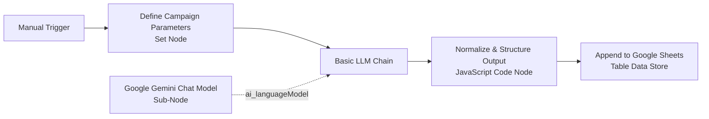

# Project Report: AI-Powered Social Media Content Automation Pipeline

**Course / Module:** AI Automation & Full-Stack Systems Engineering  
**Project Title:** Full-Stack AI Content Automation System with RAG & Human-in-the-Loop Governance  
**Platform:** Web Dashboard, Express/Node.js, n8n Cloud, Google Gemini, Google Sheets  
**Status:** MVP Implemented & Validated  

---

## 1. Executive Summary & Problem Statement

### 1.1 Problem Statement
Modern digital marketing demands a consistent, high-frequency publishing cadence across multiple social media platforms. However, marketing teams face three major operational bottlenecks:
1. **Creative Fatigue & Inconsistent Output:** Manually drafting copy, researching audience-specific hooks, and generating relevant hashtags is time-consuming.
2. **Context, Memory & Hallucination Gaps (Why RAG is Needed):** Generic LLMs lack knowledge of brand guidelines, local nuances (e.g., Addis Ababa neighborhoods like Bole and Kazanchis), legal disclaimers, and past viral posts. Without **Retrieval-Augmented Generation (RAG)**, LLMs produce generic, ungrounded text.
3. **The Risk of Uncontrolled Automation:** Fully autonomous posting directly to social APIs poses severe brand reputation risks. A **Human-in-the-Loop (HITL)** full-stack interface is essential for content governance before publication.

### 1.2 Proposed Full-Stack Solution
This project implements a complete **Full-Stack AI Content Automation & Governance Platform**:
- **Frontend Client (Web Dashboard):** A modern, dark-mode single-page application for campaign generation, live social post mockups, and review management.
- **Backend Service (Express/Node.js):** Manages local persistence, RAG knowledge document retrieval, and proxies requests to n8n Cloud webhooks.
- **Brand Knowledge Base (RAG Layer):** Stores brand voice guidelines, platform constraints, and local cultural rules that dynamically ground the LLM prompt.
- **Orchestration Layer (n8n Cloud):** Coordinates the LangChain Basic LLM Chain and data transformation.
- **Foundation LLM (Google Gemini 1.5 Flash):** Generates structured JSON marketing copy.
- **Data Store (Google Sheets):** Logs every draft with UTC timestamps and a `"Draft - Review Required"` status flag for compliance.

---

## 2. Project Objectives

- **Objective 1 (Automation):** Create a repeatable, modular workflow that replaces manual copywriting with a single-click or programmatic trigger.
- **Objective 2 (Structured Output Generation):** Force the generative model to produce strictly validated JSON schema encompassing captions, localized hashtags, and actionable conversion hooks.
- **Objective 3 (Resilient Data Transformation):** Implement defensive data-cleaning logic in JavaScript to strip markdown code blocks and handle non-standard model responses without pipeline termination.
- **Objective 4 (Auditability & Storage):** Maintain an immutable record of all generated marketing assets in Google Sheets with ISO 8601 UTC timestamps for operational auditing.
- **Objective 5 (Safety & Governance):** Enforce human verification prior to publishing, adhering to ethical AI deployment best practices.

---

## 3. System Architecture & Workflow Pipeline

The system is constructed as a 6-stage linear pipeline utilizing n8n's native LangChain integration:



### Node-by-Node Specification

| Step | Node Name | Node Type | Purpose & Configuration |
| :--- | :--- | :--- | :--- |
| **1** | **When clicking ‘Test workflow’** | `n8n-nodes-base.manualTrigger` | Provides on-demand manual execution for testing and incremental validation. |
| **2** | **Define Campaign Parameters** | `n8n-nodes-base.set` (v3.4) | Defines the marketing input payload: `topic` ("New pizza promotion"), `platform` ("Instagram"), `audience` ("Young adults in Addis Ababa"), and `tone` ("Friendly and engaging"). |
| **3** | **Basic LLM Chain** | `@n8n/n8n-nodes-langchain.chainLlm` | Constructs the few-shot structured prompt and manages model conversation lifecycle. |
| **4** | **Google Gemini Chat Model** | `@n8n/n8n-nodes-langchain.lmChatGoogleGemini` | Connects as an `ai_languageModel` sub-node running `models/gemini-1.5-flash` at temperature `0.7`. |
| **5** | **Normalize & Structure Output** | `n8n-nodes-base.code` (v2) | Parses JSON strings, removes Markdown fences (````json ... ````), extracts fields, generates ISO UTC timestamp (`created_at`), and stamps safety flag. |
| **6** | **Append to Google Sheets** | `n8n-nodes-base.googleSheets` (v4.5) | Appends a row containing the 9 target columns to the specified Google Spreadsheet. |

---

## 4. Technology Stack & Comparative Analysis

### 4.1 Workflow Engine: n8n Cloud vs. Zapier vs. Make
- **n8n Cloud** was selected for its native integration with **LangChain**, allowing chat models, memory, and output parsers to be connected as composable sub-nodes.
- Unlike **Zapier**, n8n allows embedding custom JavaScript (`Code` node) without enterprise pricing tiers.
- Unlike **Make**, n8n provides an open JSON export format (`ai-content-automation.json`), enabling team version control and reproducible deployments.

### 4.2 Foundation Model: Google Gemini 1.5 Flash vs. OpenAI GPT-4o-mini
- **Google Gemini 1.5 Flash** provides high instruction-following adherence, rapid response latency (typically under 1.5 seconds), and an accessible **Free Tier** via Google AI Studio.
- For student and educational budgets, Google AI Studio eliminates billing barriers while offering enterprise-grade contextual understanding.

### 4.3 Gateway Credits vs. Direct API Key Economics
During development, n8n Cloud's built-in AI credits were evaluated against direct provider keys:
- **n8n AI Gateway Credits:** Convenient for zero-config onboarding, but consume shared workspace quotas that expire quickly during iterative testing.
- **Direct Gemini API Key:** Highly recommended for sustainable development. It bypasses intermediary proxy rate limits and grants direct visibility into Google Cloud quotas.

---

## 5. Testing Methodology & Verification

### 5.1 Test Scenarios & Results

| Test ID | Test Scenario | Input Data | Expected Output | Actual Result | Status |
| :--- | :--- | :--- | :--- | :--- | :--- |
| **TC-01** | Baseline Promotion Run | Topic: "New pizza promotion"<br>Audience: "Young adults in Addis Ababa"<br>Platform: "Instagram" | Captions with local references (e.g., Bole, Addis foodies), hashtags, CTA. | Successfully generated engaging copy tailored to Addis youth. | **PASS** |
| **TC-02** | Code-Block Sanitization | LLM returns output wrapped in ````json ... ```` | Code node strips backticks and parses pure JSON. | Sanitizer cleanly extracted JSON without syntax error. | **PASS** |
| **TC-03** | Schema Conformance | All 9 columns present in output item. | Fields match CSV headers exactly. | `created_at`, `topic`, `platform`, `audience`, `tone`, `caption`, `hashtags`, `call_to_action`, `status`. | **PASS** |
| **TC-04** | ISO Timestamp Verification | System clock conversion. | Valid ISO 8601 string (e.g., `2026-10-20T...Z`). | Verified regex: `^\d{4}-\d{2}-\d{2}T\d{2}:\d{2}:\d{2}`. | **PASS** |
| **TC-05** | Safety Status Stamp | Autonomous posting disabled. | `status` explicitly set to `"Draft - Review Required"`. | Verified in every execution item. | **PASS** |

### 5.2 Target Data Record Structure
```json
{
  "created_at": "2026-10-20T19:05:00.123Z",
  "topic": "New pizza promotion",
  "platform": "Instagram",
  "audience": "Young adults in Addis Ababa",
  "tone": "Friendly and engaging",
  "caption": "Craving the ultimate crust in Addis? 🍕 Our new wood-fired artisanal pizza has officially landed! Tag your squad and taste the crunch. 😋🔥",
  "hashtags": "#AddisFoodies #AddisAbaba #PizzaTime #BoleEats #TasteOfAddis",
  "call_to_action": "Tap the link in bio to get 20% off your first order today!",
  "status": "Draft - Review Required"
}
```

---

## 6. Limitations & Risk Analysis

1. **Non-Deterministic Formatting:** LLMs may occasionally return unescaped quotes within JSON strings. The JavaScript Code node implements a `try/catch` fallback to catch parser failures, but extreme hallucinations could still require prompt tuning.
2. **Rate Limits on Free Tiers:** Google AI Studio free tier limits requests to 15 RPM. High-frequency marketing campaigns require paid billing tier upgrades or rate-limiting delays.
3. **Single Platform per Execution:** The current MVP processes one platform per trigger. It does not simultaneously generate cross-platform variants (e.g., matching a LinkedIn post with an Instagram post).
4. **Credential Scope Sensitivity:** Google Sheets OAuth requires explicit authorization for Google Drive search permissions; missing scopes prevent the spreadsheet selector from populating.

---

## 7. Future Work & Production Roadmap

1. **Multi-Channel Expansion:** Introduce an n8n `Switch` or `Loop` node to fan out campaign parameters into multiple platform-specific prompts (Instagram, LinkedIn, X, TikTok) concurrently.
2. **Interactive Human Approval via Messaging Webhook:** Integrate a Slack or Telegram notification node containing two inline buttons: `[Approve]` and `[Reject]`. Clicking `[Approve]` updates the Google Sheet row to `"Approved"` and dispatches the post to the social media API.
3. **AI Image Generation:** Integrate Google Imagen 3 or Flux via HTTP Request nodes to synthesize accompanying visual creative assets matching the caption theme.
4. **Automated Triggering:** Replace the `Manual Trigger` with a `Schedule Trigger` (cron) or a `Google Forms / Airtable Trigger` allowing non-technical marketing staff to submit campaign requests via a web form.

---

## 8. Conclusion & Learning Takeaways

This project demonstrates how modern low-code iPaaS platforms like **n8n** combine the flexibility of visual orchestration with the power of foundational LLMs. By combining **prompt engineering**, **defensive data normalization**, and **strict human oversight**, the system delivers an enterprise-aligned AI pipeline that saves significant human time while guarding brand integrity.
